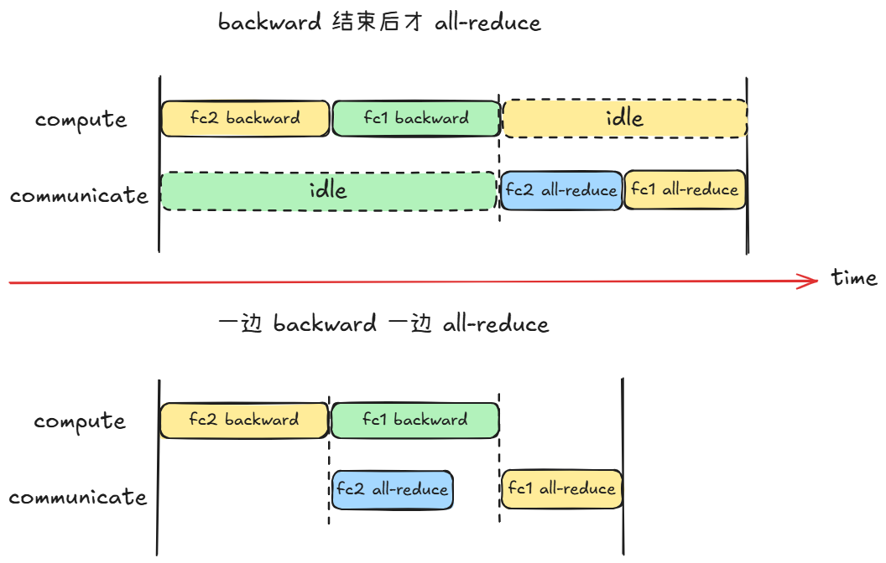
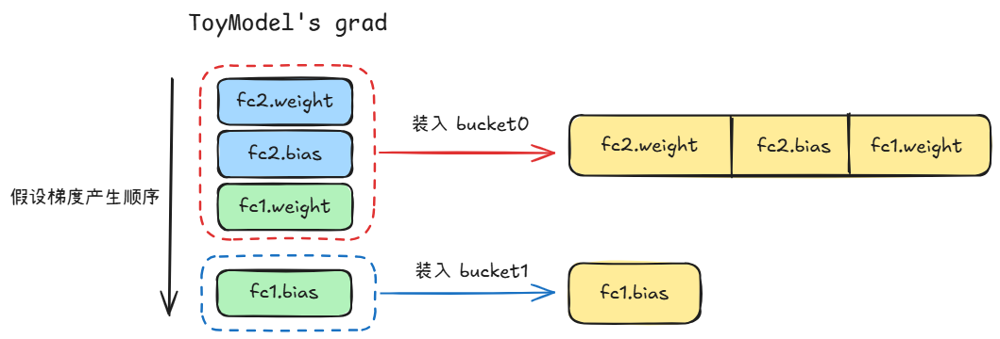

# 从零实现 PyTorch DistributedDataParallel (DDP) 核心机制

> DDP 是一切分布式训练系统的基础，我们将从手写 DDP 开始，逐步学习掌握现代分布式训练系统。

## Phase 0: DDP 的宏观理解

不谋全局者，不足谋一域。在进入 DDP 的代码实现细节之前，如果跳过宏观的设计背景，很容易陷入“只见树木，不见森林”的自嗨中。

工业界任何技术的演进，都是为了解决具体的“痛点”。在深入代码之前，我们需要先对 PyTorch DDP 有一个宏观认识，以更好的理解它为了解决工业界大规模训练痛点而设计的核心功能。

### 1. DDP 的核心目标

让多张 GPU 并行处理输入数据，提高**吞吐量**，同时保证**训练结果**与单卡大 batch size 完全**等价**。

### 2. 为什么需要 DDP ？

可以从**提高训练速度**和**突破单卡 batch size 限制**这两个方面来理解：

* 假设当前单卡 batch size = 32，如果使用 N 张卡来处理这 32 个样本，每张卡只需要处理 32/N 个样本，由于单卡数据量成倍减少，训练时间几乎也会成倍减少（但实际加速比会受到通信开销和 GPU 利用率等因素影响，加速比通常小于 N）。所以，通过使用多张 GPU 来**数据并行**可以大幅度加快训练过程；

* 假设 batch size = 32 时，每个 epoch 需要训练 10000 个 step，为了减少 step 数量以减少训练时间，或者发现更大的 batch size 训练出的模型性能更好，我们就需要增大 batch size，但是，受限于单卡的显存容量，batch size 最多只能设置为 32。这时要增大 batch size，该怎么办呢？只能使用多张 GPU 啦。

  > 额外提醒一下大家，这里提到增大 batch_size 可以加快训练速度，但要注意不能盲目增大，一般而言，大 batch_size 需要配合学习率缩放等更精细的调优。因此真实场景中，正确流程一般是：先通过实验选定一个较优的全局 batch size（及对应的学习率），再根据显存和速度需求，用 DDP（+ 梯度累积）把 batch size 分配到多卡上，而不是反过来用 DDP 无限放大 batch size。

综上两个原因，我们需要使用 DDP 来做数据并行，提高训练速度或者突破单卡 batch size 限制。这在大模型训练中，面对海量的输入样本时尤为重要。

### 3. DDP 是怎么训练的？

假设 GPU0 上参数 $\theta$ 的梯度为 $g_0$， GPU1 上参数 $\theta$ 的梯度为 $g_1$，学习率为 $lr$，两张卡各自更新参数（以 SGD 优化器为例）：

* GPU0：

$$
\theta_0 = \theta - lr * g_0
$$
  
* GPU1：

$$
\theta_1 = \theta - lr * g_1
$$
  

由于输入不同，所以 $g_0 \neq g_1$，于是 $\theta_0 \neq \theta_1$，若两张 GPU 使用各自的参数（ $\theta_0$ 和 $\theta_1$ ）进行下一步迭代，模型的参数差距会越来越大，最终导致每张 GPU 各自训练一个模型，这显然不是我们想要的。DDP 为了解决这个问题，采用如下策略：

* 每张卡分别计算各自的梯度 $g_i$， $i \in \{0,1,\dots,N-1\}$，N 为总的 GPU 数量

* 再计算平均梯度

$$
g_{avg} = \frac{1}{N} \sum_{i=0}^{N-1} g_i
$$

* 然后每张卡使用相同的梯度 $g_{avg}$ 更新参数

$$
\theta_0 = \theta_0 - lr * g_{avg}
$$

$$
\theta_1 = \theta_1 - lr * g_{avg}
$$
  

这就保证了每张卡上的参数始终一致。

### 4. 为什么 DDP 等价于单卡大 batch size 训练？

大家或许会好奇，为什么对**梯度做一下全局归约**就让 DDP 等价于单卡大 batch size 了呢？

假设共有 N 张 GPU，每张卡上计算出的损失为 $l_i$， $i \in \{0,1,\dots,N-1\}$，则在**单卡场景**下：

* 单卡 loss：

$$
L = \frac{1}{N} \sum_{i=0}^{N-1} l_i
$$

* 梯度（ $\nabla_{\theta} L$ 表示损失函数 $L$ 关于参数 $\theta$ 的梯度）：

$$
\nabla_{\theta} L = \nabla_\theta \left( \frac{1}{N} \sum_{i=0}^{N-1} l_i \right)
$$

* 利用梯度线性性：

$$
\nabla_{\theta} L = \frac{1}{N} \sum_{i=0}^{N-1} \nabla_\theta l_i
$$

在多卡场景下：

* 第 $i$ 张卡的梯度：

$$
g_i = \nabla_\theta l_i
$$

* 对每张卡的梯度做全局归约：

$$
g_{avg} = \frac{1}{N} \sum_{i=0}^{N-1} \nabla_\theta l_i
$$

* 这正好就是单卡场景中的 $\nabla_{\theta} L$，即：

$$
g_{avg} = \nabla_{\theta} L = \frac{1}{N} \sum_{i=0}^{N-1} \nabla_\theta l_i
$$

所以 DDP 的全局归约梯度与单卡大 batch size 的梯度是一样的，基于相同的梯度更新参数，训练结果当然就是等价的啦！

### 5. 拓展思考

大家可能想问：

* 既然最后每张卡的参数要一样，那为什么不能每张显卡各自更新参数，最后再同步参数？
* 为什么不能只同步每张卡的 loss？

先来看看第一个问题，每张卡单独更新参数，即：

$$
\theta_i = \theta - lr * g_i
$$

最后同步：

$$
\begin{aligned}
\theta &= \frac{1}{N} \sum_{i=0}^{N-1} \theta_i \\
&= \frac{1}{N} \sum_{i=0}^{N-1} (\theta - lr * g_i) \\
&= \theta - lr * \frac{1}{N} \sum_{i=0}^{N-1} g_i \\
&= \theta - lr * g_{avg}
\end{aligned}
$$

乍一看，似乎和同步梯度的效果一样欸！但实际上，这只在使用 **SGD 优化器**时成立。可是，现代的大模型训练根本不用纯 SGD，所以这种方法实际不可行！

以 Adam 优化器为例：

其维护一阶动量 $m$ 和二阶动量 $v$，参数更新公式为：

$$
\begin{aligned}
& m_t = \beta_1 \cdot m_{t-1} + (1 - \beta_1) \cdot g_t \\
& v_t = \beta_2 \cdot v_{t-1} + (1 - \beta_2) \cdot (g_t \odot g_t) \\
& \hat{m}_t = \frac{m_t}{1 - \beta_1^t} \\
& \hat{v}_t = \frac{v_t}{1 - \beta_2^t} \\
& \theta_t = \theta_{t-1} - lr \cdot \frac{\hat{m}_t}{\sqrt{\hat{v}_t} + \epsilon}
\end{aligned}
$$

显然，这并不具备 SGD 优化器那样的同步参数与同步梯度等价的条件。所以，**不能**每张显卡各自更新参数，最后再同步参数！

再来看看第二个问题，为什么不能只同步每张卡的 loss？

大家可能会想，每张卡上的梯度有一大堆，而 loss 只是一个标量值，如果直接同步 loss，那通信量岂不是能减少很多。

但很可惜，这在数学上不成立：由于输入不同，每张卡上的激活值也不相同，就算同步了 loss，计算出的梯度也不相同，用不同的梯度更新参数，结果当然不对。而且，loss 是与输入和激活值紧密联系的，用同步后的 loss 与每张卡上自己的激活值计算梯度，这样算出的梯度本身就是错误的。

所以，综上所述，多卡数据并行既不能每张显卡各自更新参数，最后再同步参数，也不能只同步每张卡的 loss，只能：

* 每张 GPU 持有完全相同的初始模型参数；
* 每张 GPU 用不同数据计算局部梯度；
* All Reduce 求平均梯度； 
* 所有 GPU 用相同梯度更新参数。

### 6. DDP的总体架构

PyTorch DDP 主要包含如下组件：

```python
DDP
│
├── ProcessGroup
│
├── Reducer
│
├── Buckets
│
├── Grad Hooks
│
├── Communication Backend
│
├── Parameter Broadcast
│
└── Join / Static Graph 等高级功能
```

真正核心只有两个：

```python
Reducer
Buckets
```

其它基本都是辅助。

后续内容我们会从一个最小可运行 DDP 开始，逐步实现 PyTorch DDP 的核心设计。

## Phase 1: 实现一个最小可运行 DDP

目标：

* 手动完成 DDP 的一次训练迭代，让大家理解 DDP 在干什么；

* 让大家看到：DDP 的核心算法只有几十行代码，复杂度主要来自性能优化，而不是分布式训练的数学原理；

* 从最朴素但正确的版本开始，先只实现：

```python
2 process
Parameter Synchronization
forward
backward
all_reduce gradients
optimizer step
```

说明：

* 这里会构建一个两进程的 DDP，如果大家手中**没有多卡设备**也不用担心，我会实现一个兼容**纯 CPU** 的版本，哪怕没有 GPU 的电脑也可以运行，足够大家理解 DDP 的工作原理；
* 直接使用 [torch.distributed](https://pytorch.ac.cn/tutorials/intermediate/dist_tuto.html) 包中的集合通信原语，而不会深入到通信库底层实现。

### 1. Step 1: 模型参数同步

在使用 PyTorch DDP 的案例中，我们常常能看到如下代码：

```python
model = MyModel().to(device)
ddp_model = DDP(model)
```

使用 DDP 包装 model 时，发生了极其关键的操作 —— 同步**不同进程间**的模型参数，确保不同进程持有的模型参数完全一致。通常会使用 rank=0 的进程作为源头，进行 `dist.broadcast` 操作：

```python
def _sync_module_states(module: nn.Module) -> None:
    """
    Broadcast every parameter and buffer from rank 0 → all ranks.

    Collective : dist.broadcast  (one call per tensor)
    Postcondition : every rank holds byte-identical weight tensors.
    """
    module_states = list(module.parameters()) + list(module.buffers())
    with torch.no_grad():
        for tensor in module_states:
            # All ranks call broadcast; rank 0 is the source (src=0).
            # Ranks 1..N-1 receive rank-0's data, overwriting their own.
            dist.broadcast(tensor, src=0)
```

为什么一定要进行不同进程间的参数同步？

* 不同进程可能由于随机初始化、初始化逻辑差异、Checkpoint 加载逻辑不同等原因，持有**不同的模型参数**；
* 若参数不同，后续优化器更新时，由于**参数的起点不同**，每个进程的**模型**就会越来越**发散**，这就相当于每个进程单独训练一个模型；
* 为了保证每个进程起点相同，必须进行**参数同步**！

有人可能会想，如果我给每个进程设置**相同的随机种子**，保证每个进程的模型初始化参数完全相同，岂不是可以避免一次广播操作？

* 很棒的想法！理论上确实如此。如果所有进程使用相同的随机种子，并且模型构建过程中随机数的消耗顺序完全一致，那么各个进程得到的初始参数本身就是逐 bit 相同的；
* 但 DDP **无法保证**用户一定**满足这些条件**。例如不同进程可能执行了**不同的初始化逻辑**、加载了**不同的 checkpoint**，或者在模型构建前额外消耗了随机数，这些都会导致模型参数出现差异；
* 而 DDP 的**核心前提**是：所有进程在第一次 Forward 开始前必须持有**完全一致**的模型参数。因此 PyTorch 会在 DDP 初始化阶段主动执行一次参数广播，以 rank=0 的参数为准覆盖其他进程，从而建立这一前提条件；
* 这样做的好处是，无论用户之前进行了什么操作，DDP 都能确定所有进程的模型状态完全一致。相比后续训练过程中持续发生的梯度通信，这一次性的**参数同步开销**通常可以**忽略不计**。

> 总结：DDP要求所有 rank 的参数一致，而广播是最简单、最可靠的保证手段。

### 2. Step 2: forward 

和单卡训练的方式一样，只不过使用被 DDP 包装过的 model

```python
output = ddp_model(x)        # x 是训练数据
loss = criterion(output, y)  # y 是标签
```

### 3. Step 3: backward 

每个进程都会独立计算出梯度，用于下一步的 All reduce

```python
loss.backward()
```

### 4. Step 4: All-reduce gradients

同步所有进程的梯度，优化器使用同步后的梯度更新参数

```python
def all_reduce_gradients(module: nn.Module, world_size: int) -> None:
    """
    Average gradients across all ranks.
    
    Args:
    	module (nn.Module): your model
    	world_size (int): the number of processes in the current process group
    """
    with torch.no_grad():
        for param in module.parameters():
            if param.grad is not None:
                dist.all_reduce(param.grad, op=dist.ReduceOp.SUM)
                param.grad.div_(world_size) 
```

### 5. MiniDDP

我们参考 PyTorch DDP 的设计，将模型参数同步、forward 和 All-reduce gradients 封装成 MiniDDP：

```python
import torch
import torch.nn as nn
import torch.distributed as dist

class MiniDDP(nn.Module):
    """
    Minimal DDP wrapper
    """
    def __init__(self, module: nn.Module) -> None:
        super().__init__()
        self.module = module
        # Return the number of processes in the current process group
        self.world_size = dist.get_world_size() 
        # Return the rank of current process within process group
        self.rank = dist.get_rank()
        # Parameter Synchronization
        self._sync_module_states()
    
    # =================================================================
    # Step 1: Parameter Synchronization
    # =================================================================
    def _sync_module_states(self) -> None:
        """
        Broadcast every parameter and buffer from rank 0 → all ranks.

        Collective : dist.broadcast  (one call per tensor)
        Postcondition : every rank holds byte-identical weight tensors.
        """
        module_states = list(self.module.parameters()) + list(self.module.buffers())
        with torch.no_grad():
            for tensor in module_states:
                # All ranks call broadcast; rank 0 is the source (src=0).
                # Ranks 1..N-1 receive rank-0's data, overwriting their own.
                dist.broadcast(tensor, src=0)

    # =================================================================
    # Step 2: Forward
    # =================================================================
    def forward(self, *args, **kwargs):
        """
        pass-through, no collective.
        """
        return self.module(*args, **kwargs)
    
    # =================================================================
    # Step 3: loss.backward(), called by the user between steps 2 and 4
    # =================================================================

    # =================================================================
    # Step 4: All-reduce gradients
    # =================================================================
    def all_reduce_gradients(self) -> None:
        """
        Average gradients across all ranks.
        """
        with torch.no_grad():
            for param in self.module.parameters():
                if param.grad is not None:
                    dist.all_reduce(param.grad, op=dist.ReduceOp.SUM)
                    param.grad.div_(self.world_size)
```

然后完成 DDP 的一次训练迭代，重点观察以下几点：

* 各个进程在**模型参数同步前后**的持有的**参数**是否相同？
* All-reduce gradients 前后各个进程持有的**梯度**是否相同？
* 优化器更新后，各个进程持有的**参数**是否相同？
* Process-group initialization 的方式：
  * 使用多 GPU 设备时，通信后端选择 `nccl`
  * 使用纯 CPU 时，通信后端选择 `gloo`

训练代码如下，如果你的设备没有多张 GPU，可以将 train 函数的 `use_cpu` 参数设置为 True。

```python
import os
import torch
import torch.nn as nn
import torch.distributed as dist
from MiniDDP import MiniDDP # 假设 MiniDDP 类位于 MiniDDP.py 文件中

# config
class config:
    BATCH_SIZE = 1
    IN_DIM = 16
    STEP = 1

# simple model
class ToyModel(nn.Module):
    def __init__(self, in_dim=16, hidden_dim=32, out_dim=1):
        super().__init__()
        self.fc1 = nn.Linear(in_dim, hidden_dim)
        self.fc2 = nn.Linear(hidden_dim, out_dim)
        self.relu = nn.ReLU()
    
    def forward(self, x):
        return self.fc2(self.relu(self.fc1(x)))
    
def train(use_cpu: bool = False):
    # 1. Process-group initialization
    if use_cpu:
        dist.init_process_group(backend="gloo",)
        local_rank = int(os.environ["LOCAL_RANK"])
        device = torch.device("cpu")
    else:
        dist.init_process_group(backend="nccl",)
        local_rank = int(os.environ["LOCAL_RANK"])
    
        torch.cuda.set_device(local_rank)
        device = torch.device(f"cuda:{local_rank}")

    # 2. Wrap model with MiniDDP
    model = ToyModel(in_dim=config.IN_DIM).to(device)
    print(
        f"[Rank {local_rank}] before MiniDDP "
        f"fc1.weight[0,0] = {model.fc1.weight[0,0].item():.6f}"
    )
    
    ddp_model = MiniDDP(model)
    
    print(
        f"[Rank {local_rank}] after MiniDDP "
        f"fc1.weight[0,0] = {model.fc1.weight[0,0].item():.6f}"
    )
    
    optimizer = torch.optim.SGD(ddp_model.parameters(), lr=1e-3)
    criterion = nn.MSELoss()

    # 3. Training loop
    for _ in range(config.STEP):
        # generate input
        x = torch.randn(config.BATCH_SIZE, config.IN_DIM, device=device)
        y = torch.randn(config.BATCH_SIZE, 1, device=device)

        # forward
        optimizer.zero_grad()
        output = ddp_model(x)
        loss = criterion(output, y)

        # backward       
        loss.backward()

        # all-reduce gradients
        print(
            f"[Rank {local_rank}] before All Reduce "
            f"grad = {model.fc1.weight.grad[0,0].item():.6f}"
        )
        
        ddp_model.all_reduce_gradients()
        
        print(
            f"[Rank {local_rank}] after All Reduce "
            f"grad = {model.fc1.weight.grad[0,0].item():.6f}"
        )

        # optimize
        optimizer.step()
        print(
            f"[Rank {local_rank}] after optimize "
            f"fc1.weight[0,0] = {model.fc1.weight[0,0].item():.6f}"
        )
    
    # clean up
    dist.destroy_process_group()

if __name__ == "__main__":
    train(True)
```

假设文件保存为 `train.py`，启动方式（终端运行）：

```bash
torchrun --standalone --nproc_per_node=2 train.py
```

运行结果如下：

```python
[Rank 0] before MiniDDP fc1.weight[0,0] = 0.187006
[Rank 1] before MiniDDP fc1.weight[0,0] = -0.201484
[Rank 0] after MiniDDP fc1.weight[0,0] = 0.187006
[Rank 1] after MiniDDP fc1.weight[0,0] = 0.187006

[Rank 0] before All Reduce grad = -0.000000
[Rank 1] before All Reduce grad = -0.132528
[Rank 0] after All Reduce grad = -0.066264
[Rank 1] after All Reduce grad = -0.066264

[Rank 1] after optimize fc1.weight[0,0] = 0.187073
[Rank 0] after optimize fc1.weight[0,0] = 0.187073
```

可以发现：

* 各个进程在模型参数**同步前**持有的参数并**不相同**，但参数**同步后**，各个进程都持有 **rank=0** 的进程的模型参数；
* All-reduce gradients **前**各个进程持有的**梯度**不同，但 All-reduce **后**相同；
* 优化器更新后，各个进程持有的**参数完全相同**。

### 6. 思考题

学习了上述内容，大家可以尝试回答一下如下问题：

* 为什么 DDP 同步梯度而不是同步 Loss？
* 为什么初始化时，要同步模型参数？
* 为什么 AllReduce 之后还要除 world_size？
* 为什么 DDP 等价于大 Batch 训练？
* 为什么更新后参数还能保持一致？

如果这些问题都能解释清楚，那么你已经掌握了 DDP 最核心的数学原理和训练流程。后面的 Hook、Reducer、Bucket，本质上都只是围绕 **“如何更高效地完成这套流程”** 所做的工程优化。

## Phase 2: 计算与通信重叠

目标：

* 加入 Autograd Hook，在每个参数梯度计算完成后立即触发异步的 All-reduce 操作，而不是等到 `loss.backward()` 完成后才同步梯度，通过这种方式实现反向传播梯度计算与通信的重叠，加速训练过程；

### 1. 当前存在的问题与解决方法

Phase 1 实现的 MiniDDP 是在反向传播完成后才进行梯度的通信（All-reduce），这意味着：

* 反向传播时，通信部分是完全闲置的；
* 全局通信时，计算部分是完全闲置的；

如何进一步优化呢？可以参考算子开发中，通过构建**异步流水线**使**访存与计算重叠**的优化思想，反向传播时一边计算梯度，一边发起通信，通过计算与通信的重叠，减少总的耗时，如下图所示：



### 2. Step 1: 修改 MiniDDP

要实现计算与通信的重叠，我们需要使用 **Autograd Hook** 机制，主要修改点包括：

* _register_gradient_hooks：为所有需要计算梯度的参数注册反向传播 Hook；
* 使用异步 All-reduce：`dist.all_reduce(..., async_op=True)`；
* wait_for_gradients：在 `loss.backward()` 之后，`optimizer.step()` 之前调用，确保所有梯度完成通信并正确写入。

修改后的 MiniDDP 代码如下，这里介绍两种写法，更推荐第一种，写法简单、更容易保证正确性。

> 如果觉得同时看两种看不过来，就先只看第一种，等未来完全消化了这些知识再看第二种

* 第一种：使用 `register_post_accumulate_grad_hook` 为参数注册 hook：

  * `register_post_accumulate_grad_hook` 的特点是在 `param.grad` **累积完成后**触发；
  * hook 直接收到 `param`，此时 hook 操作的 `param.grad` 就是 Optimizer 后续将要使用的梯度缓冲区。因此异步 all_reduce 完成后，直接原地修改该 `param.grad` 即可，无需再额外同步 `grad` 与 `param.grad`；

  ```python
  class MiniDDP(nn.Module):
      """
      Minimal DDP wrapper with overlapped computation and communication
      """
      def __init__(self, module: nn.Module) -> None:
          super().__init__()
          self.module = module
          self.world_size = dist.get_world_size() 
          self.rank = dist.get_rank()
          self._sync_module_states()
  
          # Collect handles of asynchronous communication
          self.reduction_handles = []
          # Register autograd hook
          self._register_gradient_hooks()
      
      def _sync_module_states(self) -> None:
          module_states = list(self.module.parameters()) + list(self.module.buffers())
          with torch.no_grad():
              for tensor in module_states:
                  dist.broadcast(tensor, src=0)
  
      def forward(self, *args, **kwargs):
          return self.module(*args, **kwargs)
      
      def _register_gradient_hooks(self) -> None:
          """
          为所有需要计算梯度的参数注册反向传播 Hook
          """
          for param in self.module.parameters():
              if param.requires_grad:              
                  # 触发时机：param.grad 已经写入完毕
                  param.register_post_accumulate_grad_hook(self._make_hook())
      
      def _make_hook(self):
          """
          工厂函数，返回一个被 Autograd 调用的 hook 函数
          """
          def hook(param): # ← 参数是 param, 不是 grad
              # 当这个 hook 被触发时, 立即发起异步的 all-reduce
              handle = dist.all_reduce(param.grad, op=dist.ReduceOp.SUM, async_op=True)           
              self.reduction_handles.append((param.grad, handle))
          return hook
  
      def wait_for_gradients(self) -> None:
          """
          在 optimizer.step() 之前调用,
          阻塞等待所有后台的异步通信完成, 并除以 world_size.
          """
          with torch.no_grad():
              # 遍历所有收集到的异步句柄
              for grad, handle in self.reduction_handles:
                  handle.wait()  # 阻塞当前流, 直到这个 grad 的 all-reduce 完成
                  # 这里的 grad 就是 param.grad, 原地修改即生效
                  grad.div_(self.world_size) 
                  
          # 清空列表, 为下一次 backward 做准备
          self.reduction_handles.clear()
  ```

* 第二种，使用 `register_hook` 为参数注册 hook：

  * `param.register_hook(hook)` 注册的 hook 在梯度计算完成后、`param.grad` **被赋值之前**触发。Backward 引擎拿到 hook 的返回值后，会检查该张量的引用计数，再决定是直接占用还是先 clone 再赋值；
  * 简单来说，就是**不能保证** hook 函数接收的 `grad` 和 `param.grad` 一定指向相同的内存，因此 `wait_for_gradients` 函数中 `grad.div_(self.world_size)` 并不能保证 `param.grad` 一定被正确修改，所以为了保证正确性，需要增加一步操作：`param.grad.copy_(grad)`；
  * 与第一种写法相比，这种写法更麻烦，也更容易出错。因此**更推荐第一种写法**！

  ```python
  class MiniDDP(nn.Module):
      """
      Minimal DDP wrapper with overlapped computation and communication
      """
      def __init__(self, module: nn.Module) -> None:
          super().__init__()
          self.module = module
          self.world_size = dist.get_world_size() 
          self.rank = dist.get_rank()
          self._sync_module_states()
  
          # Collect handles of asynchronous communication
          self.reduction_handles = []
          # Register autograd hook
          self._register_gradient_hooks()
      
      def _sync_module_states(self) -> None:
          module_states = list(self.module.parameters()) + list(self.module.buffers())
          with torch.no_grad():
              for tensor in module_states:
                  dist.broadcast(tensor, src=0)
  
      def forward(self, *args, **kwargs):
          return self.module(*args, **kwargs)
      
      # =================================================================================
      # 以下 3 个函数均有修改
      # =================================================================================
      def _register_gradient_hooks(self) -> None:
          """
          为所有需要计算梯度的参数注册反向传播 Hook
          """
          for param in self.module.parameters():
              if param.requires_grad:              
                  param.register_hook(self._make_hook(param)) # ------------- 不同点
      
      def _make_hook(self, param):
          """
          工厂函数, 返回一个被 Autograd 调用的 hook 函数
          """
          def hook(grad):  # ← 参数是 grad, 不是 param ------------------------ 不同点
              # 这个 hook 被触发时, 立即发起异步的 all-reduce
              handle = dist.all_reduce(grad, op=dist.ReduceOp.SUM, async_op=True)           
              self.reduction_handles.append((param, grad, handle)) # -------- 不同点
              return grad # ------------------------------------------------- 不同点
          return hook
  
      def wait_for_gradients(self) -> None:
          """
          在 optimizer.step() 之前调用,
          阻塞等待, 直到后台的异步通信完成, 并除以 world_size.
          """
          with torch.no_grad():
              # 遍历所有收集到的异步句柄
              for param, grad, handle in self.reduction_handles: # ----------- 不同点
                  handle.wait()  # 阻塞当前流, 直到这个 grad 的 all-reduce 完成
                  grad.div_(self.world_size)
                  # grad 与 param.grad 指向的内存不保证相同, 所以需要用 grad 修改 param.grad 的值
                  param.grad.copy_(grad)  # ---------------------------------- 不同点
                  
          # 清空列表, 为下一次 backward 做准备
          self.reduction_handles.clear()
  ```

> 这里使用 `register_post_accumulate_grad_hook` 主要是为了简化实现。在 PyTorch DDP 的实际实现中，会使用更底层的操作来完成梯度同步。


### 3. Step 2: 修改训练循环

train 函数只需要将原本的 `ddp_model.all_reduce_gradients()` 修改为 `ddp_model.wait_for_gradients()` 即可：

```python
def train(use_cpu: bool = False):
    # 前面的部分和 Phase 1 中的一样
    ......

    # 3. Training loop
    for _ in range(config.STEP):
        # generate input
        x = torch.randn(config.BATCH_SIZE, config.IN_DIM, device=device)
        y = torch.randn(config.BATCH_SIZE, 1, device=device)

        # forward
        optimizer.zero_grad()
        output = ddp_model(x)
        loss = criterion(output, y)

        # backward
        # 此时 hook 会被挨个触发, 异步通信在后台启动       
        loss.backward()

        # all-reduce gradients
        ddp_model.wait_for_gradients() # ---------------------------- 修改处        
        print(
            f"[Rank {local_rank}] after All Reduce "
            f"grad = {model.fc1.weight.grad[0,0].item():.6f}"
        )

        # optimize
        optimizer.step()
        print(
            f"[Rank {local_rank}] after optimize "
            f"fc1.weight[0,0] = {model.fc1.weight[0,0].item():.6f}"
        )
    
    # clean up
    dist.destroy_process_group()
```

同样，使用 `torchrun --standalone --nproc_per_node=2 train.py` 启动，运行结果如下：

```python
[Rank 0] before MiniDDP fc1.weight[0,0] = -0.022028
[Rank 1] before MiniDDP fc1.weight[0,0] = 0.203170
[Rank 0] after MiniDDP fc1.weight[0,0] = -0.022028
[Rank 1] after MiniDDP fc1.weight[0,0] = -0.022028

[Rank 0] after All Reduce grad = 0.043815
[Rank 1] after All Reduce grad = 0.043815

[Rank 0] after optimize fc1.weight[0,0] = -0.022072
[Rank 1] after optimize fc1.weight[0,0] = -0.022072
```

`All Reduce` 后，不同进程持有的梯度依然相同。

 ### 4. 性能测试

为了验证上述计算与通信重叠的优化效果，分别使用 Phase 1 和 Phase 2 的实现，迭代 200 次，在 CPU 上测量两种实现的运行时间，测试代码如下：

```python
import os
import time
import torch
import torch.nn as nn
import torch.distributed as dist
from MiniDDP import MiniDDP

# congfig
class config:
    BATCH_SIZE = 32       # 适当增大, 让计算时间相对噪声更显著
    IN_DIM = 256          # 同上
    HIDDEN_DIM = 1024     # 同上
    OUT_DIM = 1
    NUM_LAYERS = 20       # MLP 层数
    WARMUP_STEPS = 20     # warmup 步数
    MEASURE_STEPS = 200   # 正式计时步数

class DeepMLP(nn.Module):
    def __init__(self, in_dim=16, hidden_dim=256, out_dim=1):
        super().__init__()
        self.fc1 = nn.Linear(in_dim, hidden_dim)
        self.fc2 = nn.Linear(hidden_dim, out_dim)
        self.relu = nn.ReLU()

        layers = []
        for _ in range(config.NUM_LAYERS):
            layers.append(nn.Linear(hidden_dim, hidden_dim))
            layers.append(nn.ReLU())

        self.net = nn.Sequential(*layers)

    def forward(self, x):
        return self.fc2(self.net(self.relu(self.fc1(x))))

def run_step(ddp_model, optimizer, criterion, device):
    x = torch.randn(config.BATCH_SIZE, config.IN_DIM, device=device)
    y = torch.randn(config.BATCH_SIZE, config.OUT_DIM, device=device)
    optimizer.zero_grad()
    output = ddp_model(x)
    loss = criterion(output, y)
    loss.backward()
    # 测试 Phase 1 时换成 ddp_model.all_reduce_gradients()
    ddp_model.wait_for_gradients()
    optimizer.step()

def train(use_cpu: bool = False):
    # 1. Process-group initialization
    if use_cpu:
        dist.init_process_group(backend="gloo",)
        local_rank = int(os.environ["LOCAL_RANK"])
        device = torch.device("cpu")
    else:
        dist.init_process_group(backend="nccl",)
        local_rank = int(os.environ["LOCAL_RANK"])
    
        torch.cuda.set_device(local_rank)
        device = torch.device(f"cuda:{local_rank}")

    # 2. Wrap model with MiniDDP
    model = DeepMLP(
        in_dim=config.IN_DIM,
        hidden_dim=config.HIDDEN_DIM, 
        out_dim=config.OUT_DIM
    ).to(device)    
    ddp_model = MiniDDP(model)

    optimizer = torch.optim.SGD(ddp_model.parameters(), lr=1e-3)
    criterion = nn.MSELoss()

    # warmup
    for _ in range(config.WARMUP_STEPS):
        run_step(ddp_model, optimizer, criterion, device)
    dist.barrier()   # 确保所有进程都完成 warmup 再开始计时

    if device.type == "cuda":
        torch.cuda.synchronize()

    # 正式计时
    start = time.perf_counter()
    for _ in range(config.MEASURE_STEPS):
        run_step(ddp_model, optimizer, criterion, device)
    dist.barrier()

    if device.type == "cuda":
        torch.cuda.synchronize()
    end = time.perf_counter()

    elapsed_ms = (end - start) * 1000
    if dist.get_rank() == 0:
        print(f"{elapsed_ms:.3f} ms")
        print(f"{elapsed_ms/config.MEASURE_STEPS:.3f} ms/iter")

    # clean up
    dist.destroy_process_group()

if __name__ == "__main__":
    train(True)
```

结果如下：

| device        | Phase 1：backward 后 all-reduce | Phase 2：计算与通信重叠 |
| ------------- | ------------------------------- | ----------------------- |
| CPU（双进程） | 115.590 ms/iter                 | 96.876 ms/iter          |

表明计算与通信重叠的确能有效提升训练速度，在真正的多卡集群中，这种提升效果还会更明显。


## Phase 3: Gradient Bucketing

目标：

* 让大家理解 Bucket 思想：将 Phase 2 的 “小数据多频次通信” 转化为 “大数据低频次通信”。

说明：

* 我们的目的不是复现 PyTorch DDP 的性能，而是向大家展示 Bucket 的设计思想。

### 1. 当前存在的问题与解决方法

虽然我们在 Phase 2 中已经实现了计算与通信的重叠，但却是每算出一个梯度就触发一次同步，这在模型很小（比如我们这里的 `ToyModel`）的场景下影响不大，但对于真实的场景，对于大模型，这种方式会发起很多次通信，产生极高的延迟。

如何降低通信延迟呢？我们已经知道，延迟主要是由两个原因导致：

* 启动的通信次数过多
* 每次传输的数据量太少，带宽利用率低

所以我们需要**减少通信启动次数**，**增加每次通信的数据量**。具体来讲，就是不再以单个参数为单位去启动通信，而是将多个参数放到一个桶里，等这个桶装满了，再拿起来“倒掉”（启动 all-reduce）。

通过这种**分桶**的思想，我们可以将通信启动次数从 N_params（参数的数量） 降到 N_buckets（桶的数量），通常  N_buckets << N_params。同时，由于每次传输的数据量变成了“一桶”，数据量提高也使得**带宽利用率提高**。最终使得通信延迟大幅下降。

### 2. Step 1: 创建 GradBucket 类

首先，为存放梯度的桶设计一个专属的 `GradBucket` 类，主要包括：

* `__init__`：预分配连续 flat_buffer，为每个参数在 flat_buffer 里开一个视图，以及初始化相关变量；
* `mark_ready`：把某个参数的梯度写入 flat_buffer，并判断当前桶内的所有梯度是否都已 ready，是否能发起 all-reduce；
* `launch_allreduce`：为当前桶发起异步 all-reduce；
* `finalize`：阻塞等待 all-reduce 完成，完成后除以 `world_size` 并将结果写回各 param.grad；
* `reset`：迭代结束后重置，供下一次 backward 复用

```python
import torch
import torch.nn as nn
import torch.distributed as dist
from typing import List, Tuple, Dict

# ===================================================================
#  GradBucket: 负责单个桶的打包 / all-reduce / 解包
# =================================================================== 
class GradBucket:
    """
    核心思路：将桶内若干参数的梯度预先拷贝进一块连续 flat_buffer,
    对这块 buffer 发起一次 all-reduce, 再把结果写回各 param.grad, 
    这样 K 个桶只需 K 次通信, 而非原来的 N_params 次。
    
    为简化实现，假设同桶参数 dtype 一致。
    """
    def __init__(self, params: List[nn.Parameter], bucket_id: int) -> None:
        self.params = params
        self.bucket_id = bucket_id
 
        device = params[0].device
        dtype  = params[0].dtype 
 
        # 预分配连续 flat_buffer (all-reduce 的唯一操作对象)
        total_numel = sum(p.numel() for p in params)
        self.flat_buffer = torch.zeros(total_numel, dtype=dtype, device=device)
 
        # 为每个参数在 flat_buffer 里开一个视图
        # 视图和 flat_buffer 共享底层存储, 写视图 = 写 flat_buffer
        self.param_views: List[torch.Tensor] = []
        offset = 0
        for p in params:
            n = p.numel()
            self.param_views.append(self.flat_buffer[offset: offset + n])
            offset += n
 
        self.handle = None           # 异步 all-reduce 句柄
        self._pending = len(params)  # 还有几个梯度尚未就绪
 
    def mark_ready(self, param_idx: int) -> bool:
        """
        某个参数的梯度已写入 param.grad, 将其复制进 flat_buffer, 
        返回 True 表示本桶所有梯度均已就绪, 可以发起 all-reduce。
        """
        param = self.params[param_idx]
        if param.grad is not None:
            # 把 param.grad 写入 flat_buffer
            # view(-1) 保证形状为 1D, 与 param_views 的切片一致
            self.param_views[param_idx].copy_(param.grad.view(-1))
 
        self._pending -= 1
        return self._pending == 0  # 降到 0 → 桶满 → 可以发起 all-reduce
 
    def launch_allreduce(self, world_size: int) -> None:
        """
        桶满后立即异步启动 all-reduce
        """
        self._world_size = world_size
        self.handle = dist.all_reduce(
            self.flat_buffer, op=dist.ReduceOp.SUM, async_op=True
        )
 
    def finalize(self) -> None:
        """
        阻塞等待 all-reduce 完成, 平均后将结果写回各 param.grad, 
        在 optimizer.step() 之前、MiniDDP.wait_for_gradients() 内调用。
        """
        self.handle.wait()
        self.flat_buffer.div_(self._world_size)
 
        # 将 flat_buffer 的各段写回对应的 param.grad
        for param, view in zip(self.params, self.param_views):
            if param.grad is not None:
                param.grad.copy_(view.view_as(param.grad))
 
    def reset(self) -> None:
        """
        迭代结束后重置, 供下一次 backward 复用 (避免重新分配)
        """
        self._pending = len(self.params)
        self.handle = None
```


### 3. Step 2: 修改 MiniDDP

主要修改点包括：

* `__init__`：增加一个初始化参数 `bucket_size_mb`，用于控制每个桶的数据量上限；

  > 提醒一下大家：假如某个参数的梯度过于巨大，超过了 `bucket_size_mb`，就会让其单独成一桶，这也就意味着每个桶的实际大小并不是**只能小于等于** `bucket_size_mb`。

* `_build_buckets`：按反向传播顺序为参数分配桶，让同一个 bucket 中的参数在时间上尽量接近地完成梯度计算。以我们前面使用的 `ToyModel` 为例，如下图所示：反向传播先产生 `fc2` 层，再产生 `fc1` 层的梯度，假设 `fc2.weight`、`fc2.bias`  和 `fc1.weight` 正好能装进一个 bucket，就将其装入 bucket0，剩下的 `fc1.bias` 就装入 bucket1；

  

* `_seal_bucket`：调用 `GradBucket` 类创建桶，并建立参数到桶的映射关系；

* `_make_hook`：`hook` 函数会查询当前参数所属的桶，把当前参数标记就绪并在桶满时发起 all-reduce；

* `wait_for_gradients`：调用位置不变（在 optimizer.step() 之前调用），同时按桶的发起顺序逐个调用 `bucket.finalize()`，最后 `bucket.reset()` 所有 `bucket`。

```python
class MiniDDP(nn.Module):
    """
    Minimal DDP wrapper with bucket.

    相比逐参数 all-reduce 的改进：
    - 通信次数: N_params → N_buckets (通常 N_buckets << N_params)
    - 每次 all-reduce 操作的数据块更大, 带宽利用率更高
    """
    def __init__(self, module: nn.Module, bucket_size_mb: float = 25.0) -> None:
        super().__init__()
        self.module     = module
        self.world_size = dist.get_world_size()
        self.rank       = dist.get_rank()
        self._sync_module_states()
 
        # param id → (所属桶, 在桶内的下标)
        self._param_bucket_map: Dict[int, Tuple[GradBucket, int]] = {}
        self.buckets: List[GradBucket] = []
        self._build_buckets(bucket_size_mb)
 
        # 记录本次 backward 中已发起 all-reduce 的桶
        self._active_buckets: List[GradBucket] = []
 
        self._register_gradient_hooks()
    
    def _sync_module_states(self) -> None:
        module_states = list(self.module.parameters()) + list(self.module.buffers())
        with torch.no_grad():
            for tensor in module_states:
                dist.broadcast(tensor, src=0)

    def forward(self, *args, **kwargs):
        return self.module(*args, **kwargs)
    
    def _build_buckets(self, bucket_size_mb: float) -> None:
        """
        按反向传播顺序为参数分配桶, 让同一个 bucket 中的参数在时间上尽量接近地完成梯度计算, 
        每个桶的字节上限为 bucket_size_mb MB
        """
        bucket_bytes = int(bucket_size_mb * 1024 * 1024)
 
        # 收集需要梯度的参数，翻转为反向传播顺序
        trainable = [p for p in self.module.parameters() if p.requires_grad]
        trainable = list(reversed(trainable))
 
        cur_params: List[nn.Parameter] = []
        cur_bytes = 0
 
        for param in trainable:
            param_bytes = param.numel() * param.element_size()
            # 当前桶非空且再加入此参数会超限 → 先封桶
            if cur_params and cur_bytes + param_bytes > bucket_bytes:
                self._seal_bucket(cur_params)
                cur_params, cur_bytes = [], 0
            cur_params.append(param)
            cur_bytes += param_bytes
        # 处理最后一个桶
        if cur_params:
            self._seal_bucket(cur_params)
 
    def _seal_bucket(self, params: List[nn.Parameter]) -> None:
        """
        封装一个桶并建立 param → (bucket, idx) 的索引
        """
        bucket = GradBucket(params, bucket_id=len(self.buckets))
        for idx, p in enumerate(params):
            self._param_bucket_map[id(p)] = (bucket, idx)
        self.buckets.append(bucket)
    
    def _register_gradient_hooks(self) -> None:
        """
        为所有需要计算梯度的参数注册反向传播 Hook
        """
        for param in self.module.parameters():
            if param.requires_grad:              
                # 触发时机：param.grad 已经写入完毕
                param.register_post_accumulate_grad_hook(self._make_hook())
    
    def _make_hook(self):
        """
        工厂函数, 返回一个被 Autograd 调用的 hook 函数, 
        hook 接收的 param 参数即触发 hook 的那个参数本体 (autograd 传入), 
        通过 id(param) 查到它所属的桶, 标记就绪并在桶满时发起 all-reduce。
        """ 
        def hook(param: nn.Parameter) -> None:
            bucket, param_idx = self._param_bucket_map[id(param)]
            bucket_full = bucket.mark_ready(param_idx)
            if bucket_full:
                bucket.launch_allreduce(self.world_size)
                self._active_buckets.append(bucket)
        return hook

    def wait_for_gradients(self) -> None:
        """
        在 optimizer.step() 之前调用：
        1. 按桶的发起顺序逐个 wait, 并将结果写回 param.grad
        2. 重置所有桶供下一次 backward 复用
        """
        for bucket in self._active_buckets:
            bucket.finalize()
 
        for bucket in self.buckets:
            bucket.reset()
 
        self._active_buckets.clear()
```


### 4. 关于性能

我们的实现与 PyTorch DDP 存在一个根本性的差异：

```python
# 我们的实现: 需要两次拷贝
梯度写入 flat_buffer → all-reduce → 写回 param.grad

# PyTorch DDP: 零拷贝
param.grad 本身就是 flat_buffer 的 view, all-reduce 原地完成, 不需要额外拷贝	
```

* 实现零拷贝需要在模型初始化时预分配好连续内存，并让 Autograd 直接在这块内存上写梯度，这涉及 C++ 层的介入，超出了本教程的范围；
* GradBucket 的管理开销也不容忽视，PyTorch DDP 把所有性能敏感的逻辑：bucket 管理、hook 触发、all-reduce 调度等全部使用 C++ 进行实现，运行开销远低于我们这里的 Python 实现。

我们的实现为了让 Bucket 的核心思想易于理解，引入了两次内存拷贝和基于 Python 实现的 Bucket 管理逻辑。这些额外开销属于教学实现带来的工程代价，因此性能测试的结果更多反映实现细节，而非 Bucket 思想本身的价值。所以，这一节我们不做性能测试。

**总之：**Bucket 是个好思想，其价值在于**减少通信次数**、**提高带宽利用率**，而要把这些理论优势真正转化为性能收益，还需要**零拷贝**和**低开销的工程实现**。PyTorch DDP 两者兼具，我们的教学实现两者皆无，这是有意为之的取舍。


## Phase 4: 从 MiniDDP 到生产级 DDP

到目前为止，我们的 MiniDDP 已经具备了 PyTorch DDP 最核心的机制：参数广播、梯度分桶、异步 all-reduce、Hook 驱动的通信计算重叠。但在真实的训练场景中，它会在五类情况下失效或表现不佳。PyTorch DDP 的每一个进阶参数，都是为了解决其中之一。

---

### 1. 五个工程问题

#### 问题一：参数未参与前向传播 → `find_unused_parameters`

**MiniDDP 的缺陷**

`_register_gradient_hooks` 为所有 `requires_grad=True` 的参数都注册了 hook，`_pending` 的初始值等于桶内参数的总数。桶的 all-reduce 要等到 `_pending == 0` 才发起。

这里暗含一个假设：**每次 forward 之后，桶里的每个参数都会收到梯度**。

但是，带条件分支的模型会打破这个假设：

```python
class ConditionalModel(nn.Module):
    def forward(self, x, use_branch_b=False):
        if use_branch_b:
            return self.branch_b(x)  # 此时 branch_a 的参数根本没参与计算
        return self.branch_a(x)
```

`branch_a` 的参数在某些迭代里不参与前向，autograd 不会为它们计算梯度，它们的 hook 永远不会触发，`_pending` 永远不会归零，**整个桶卡死，训练进程挂起**。

**PyTorch 的解法**

开启 `find_unused_parameters=True` 后，每次 `forward` 结束时，DDP 从 loss 张量出发**遍历 autograd 计算图**，找出哪些参数实际参与了本次计算。没参与的参数被提前标记为"ready"——直接把它们的 `_pending` 贡献减掉，让其所在的桶仍然能正常满桶、正常通信。

**代价**：图遍历在每次迭代都要执行，对参数量大的模型开销不可忽视。这正是该选项默认关闭的原因——在明确知道模型有动态分支之前，不要开启它。

---

#### 问题二：图遍历的重复开销 → `static_graph`

**问题一的延伸**

`find_unused_parameters` 解决了动态图的问题，但引入了每轮迭代都要重新遍历计算图的开销。大多数模型的结构其实是静态的——每次迭代参与计算的参数集合完全相同，重复遍历是纯粹的浪费。

**PyTorch 的解法**

设置 `static_graph=True` 后，DDP 只在**第一次迭代**时遍历计算图并**缓存结果**（哪些参数是活跃的、它们的 hook 触发顺序），此后直接复用，不再重新遍历。

这个选项还解锁了一个额外优化：由于 hook 触发的实际顺序在第一次迭代后已知（而不是 `_build_buckets` 里猜测的"反向参数顺序"），DDP 可以**重新排列桶的划分**，让桶的边界与梯度的实际到达顺序完全对齐，进一步减少等待时间。

**使用前提**：模型结构在整个训练过程中保持不变，且每次迭代参与计算的参数集合固定。

---

#### 问题三：梯度累积时的冗余通信 → `no_sync`

**MiniDDP 的缺陷**

梯度累积是一种常见的显存节省技巧：不是每次 backward 后立刻 `optimizer.step()`，而是累积 K 次 backward 的梯度再统一更新一次参数：

```python
for i, batch in enumerate(dataloader):
    loss = model(batch) / K
    loss.backward()           # MiniDDP 的 hook 在这里触发 all-reduce
    if (i + 1) % K == 0:
        optimizer.step()
        optimizer.zero_grad()
```

MiniDDP 的 hook 在**每次** `backward` 结束后都会触发 all-reduce。K 次迭代发起了 K 次通信，但真正有必要的只有最后一次——前 K-1 次同步的是中间状态的梯度，既浪费带宽，也增加额外的通信开销（优化器只在最后一步更新，中间同步没有任何必要）。

**PyTorch 的解法**

`no_sync()` 是一个上下文管理器，进入其作用域时，DDP 将一个标志位设置为 `False`，hook 检测到这个标志后直接返回，不执行任何通信：

```python
# PyTorch DDP 的正确用法
with ddp_model.no_sync():
    for i in range(K - 1):
        loss = ddp_model(batch) / K
        loss.backward()        # hook 触发但立刻跳过，梯度只在本地累积

# 离开 no_sync 作用域，标志位自动恢复
loss = ddp_model(batch) / K
loss.backward()                # 这次正常触发 all-reduce，同步 K 步的累积梯度
optimizer.step()
```

如果要在 MiniDDP 里支持这个功能，只需两处改动：

```python
# 1. 在 MiniDDP.__init__ 里添加标志位
self.require_backward_grad_sync = True

# 2. 添加上下文管理器
@contextlib.contextmanager
def no_sync(self):
    self.require_backward_grad_sync = False
    try:
        yield
    finally:
        self.require_backward_grad_sync = True

# 3. hook 里加一个提前返回
def hook(param: nn.Parameter) -> None:
    if not self._require_backward_grad_sync:
        return          # 梯度留在 param.grad 本地累积，不做任何通信
    bucket, param_idx = self._param_bucket_map[id(param)]
    ...
```

三处改动，总计不超过 10 行。PyTorch DDP 的实现与此几乎完全相同 —— `require_backward_grad_sync` 就是真实的字段名。

---

#### 问题四：数据不均匀时的集合通信挂起 → `join`

**MiniDDP 的缺陷**

`dist.all_reduce` 是**集合通信**原语——必须所有 rank 同时调用，操作才能进行。MiniDDP 假设每个 rank 在每轮迭代都会发起相同次数的 all-reduce。

现实中，这个假设会在训练的最后阶段被打破。假设数据集有 101 条样本，batch size 为 2，分配给 2 个 rank：

- Rank 0 处理样本 0–49，共 25 个 batch，训练结束。
- Rank 1 处理样本 50–100，共 25 个完整 batch + 1 条剩余。若 DataLoader 设置了 `drop_last=False`，Rank 1 会多做一次迭代。

Rank 0 已经退出循环，但 Rank 1 在最后一次迭代里调用了 `all_reduce`。由于 Rank 0 不响应，**Rank 1 永久挂起**。

**PyTorch 的解法**

`join()` 同样是上下文管理器，其机制是：提前完成训练的 rank 不真正退出，而是继续参与集合通信，但零贡献（"幽灵通信"），维持通信的对称性，直到所有 rank 都走完自己的最后一个 batch：

```python
with ddp_model.join():
    for batch in dataloader:   # 各 rank 的 batch 数量可以不同
        loss = ddp_model(batch)
        loss.backward()
        optimizer.step()
```

这个功能与梯度同步机制本身关系不大，更多属于**分布式训练基础设施**层面的问题。`join` 的完整实现比表面看起来复杂得多（还要处理 BatchNorm 的 running stats 等状态量），大家以后遇到非均匀数据的场景再去查文档即可。

---

#### 问题五：通信算子不可替换 → `comm_hook`

**MiniDDP 的缺陷**

`GradBucket.launch_allreduce` 把通信方式硬编码为：

```python
# launch_allreduce
dist.all_reduce(self.flat_buffer, op=dist.ReduceOp.SUM, async_op=True)
# finalize 里再除以 world_size
self.flat_buffer.div_(self._world_size)
```

这在绝大多数场景下是正确的，但在大规模训练中，梯度通信往往是主要瓶颈，研究者希望在这个位置插入**梯度压缩**来降低通信量：

- **FP16 量化**：梯度从 FP32 降为 FP16 传输，通信量减半
- **PowerSGD**：低秩矩阵分解，压缩率更高但有精度损失
- **Top-K 稀疏化**：只传递绝对值最大的 K 个梯度

硬编码的 all-reduce 让这些算法完全无处切入。

**PyTorch 的解法**

`register_comm_hook` 把通信步骤抽象成一个可注入的函数。hook 接收一个 `GradBucket`，返回一个 `Future`，DDP 在合适的时机 await 这个 Future：

```python
# FP16 压缩 hook 示意
# 最简单直接的用法
from torch.distributed.algorithms.ddp_comm_hooks import default as ddp_hooks
ddp_model.register_comm_hook(state=None, hook=ddp_hooks.fp16_compress_hook)

# fp16_compress_hook 的源码实现：
# https://github.com/pytorch/pytorch/blob/main/torch/distributed/algorithms/ddp_comm_hooks/default_hooks.py
def fp16_compress_hook(
    process_group: dist.ProcessGroup,
    bucket: dist.GradBucket,
) -> torch.futures.Future[torch.Tensor]:
    
    dtype = torch.float16
    group_to_use = process_group if process_group is not None else dist.group.WORLD
    world_size = group_to_use.size()

    buffer = (
        cast(tuple[torch.Tensor, ...], bucket)[0]
        if isinstance(bucket, tuple)
        else bucket.buffer()
    )
    compressed_tensor = buffer.to(dtype).div_(world_size)

    def decompress(fut):
        decompressed_tensor = buffer
        value = fut if isinstance(fut, torch.Tensor) else fut.value()[0]
        decompressed_tensor.copy_(value)
        return decompressed_tensor

    if torch.compiler.is_compiling():
        grad = dist._functional_collectives.all_reduce(
            compressed_tensor,
            "sum",
            group_to_use,
        )
        return decompress(grad)
    else:
        fut = dist.all_reduce(
            compressed_tensor, group=group_to_use, async_op=True
        ).get_future()
        return fut.then(decompress)
```

`comm_hook` 是为研究者和基础设施工程师准备的接口，普通训练任务直接用默认的 all-reduce 即可。它的价值在于揭示了一个重要的架构思想：**通信策略和同步逻辑应当解耦** —— 这让 DDP 在不改动核心代码的前提下支持了大量算法变体。

---

### 2. 如何阅读 PyTorch DDP 源码

理解了 MiniDDP 的结构之后，阅读 PyTorch DDP 的源码就不再是从零开始 —— 你已经知道该找什么，剩下的是找到它在哪里。

#### 代码仓库的入口

PyTorch DDP 横跨 Python 层和 C++ 层，各司其职。

**Python 层**：

```
torch/nn/parallel/distributed.py
```

负责用户接口和生命周期管理，例如模型包装、no_sync、join、comm_hook、Autograd hook 注册等。

**C++ 层**：

```
torch/csrc/distributed/c10d/
```

重点关注：

```
torch/csrc/distributed/c10d/reducer.cpp
torch/csrc/distributed/c10d/reducer.h
```

这里包含了最重要的 `Reducer` 类，其承载了所有性能敏感的逻辑：bucket 管理、hook 触发、all-reduce 调度等。

> 阅读源码时，不必执着于具体函数名或版本差异。真正稳定的概念是：
> **参数同步 → Bucket → Autograd Hook → 梯度就绪 → AllReduce → Backward 收尾**。

#### 建议的阅读思路

* **Python 层**：理解 DDP 如何包装模块、注册 hook，并启动初始化广播；
* **C++ 层**：关注 Reducer 如何管理 Bucket、触发 hook、调度通信以及完成梯度收尾；
* **高级功能**（no_sync、join、comm_hook 等）建立在上述核心机制之上，可以在理解核心逻辑后再查看。

---

## 结语

回顾整个教程走过的路径：

* **最小正确实现**（逐参数 all-reduce）

  ↓	问题：通信次数 = 参数数量，带宽利用率低

* **计算与通信重叠**（Hook 驱动的异步 all-reduce）

  ↓	问题：每次通信粒度太小，无法摊薄启动开销

* **梯度分桶**（GradBucket）

  ↓        工程问题：动态图 / 图遍历开销 / 梯度累积 / 数据不均匀 / 通信策略变体

* **PyTorch DDP**

MiniDDP 和 PyTorch DDP 之间的距离，不是机制上的鸿沟，而是工程健壮性的积累。核心思路完全相同，差异在于对边界情况的处理、性能的精细打磨，以及为用户留出的扩展接口。

------

**你真正带走的，不只是 DDP**

回头再看整个演进过程，会发现我们反复使用的并不是某个 PyTorch API，而是几种在系统设计中不断出现的思维模式：

其一，**流水线思维**—— 先让正确的事情串行发生，再找计算和通信之间的空隙，把等待变成重叠。Phase 2 的 Hook 驱动的异步 all-reduce，是这个思维的一次直接实践；

其二，**批处理思维** —— 单个操作的启动开销是固定的，摊薄它的唯一方式是增大每次操作的数据量。Phase 3 的 Bucket 就是这样一个例子；

其三，**解耦思维** —— Phase 4 里 `comm_hook` 的设计揭示了一条原则：通信策略和同步逻辑应当分离，让核心机制稳定，让扩展点开放。这是所有优秀系统设计的共同气质。

------

**DDP 是起点，而不是终点**

学完 DDP，你站在了现代分布式训练体系真正的入口处。往前走，还有几个重要的方向：

- **FSDP / ZeRO**：DDP 的每张卡都持有完整的模型参数、梯度和优化器状态，当模型大到单卡装不下时，就需要把参数本身也切片分布到多卡上，这是 FSDP（Fully Sharded Data Parallel）和 ZeRO 系列优化要解决的问题；
- **张量并行（Tensor Parallelism）**：把单个算子（如矩阵乘法）本身拆分到多卡上并行计算，这是 Megatron-LM 等框架的核心技术；
- **流水线并行（Pipeline Parallelism）**：把模型按层切分，不同的卡负责不同的层，像工厂流水线一样处理多个 micro-batch。

这三个方向都比 DDP 复杂，但万变不离其宗，上述所有前沿技术底层的通信重叠机制、集合通信原语，依然沿用了你今天在 `MiniDDP` 中学到的核心思想。你在 MiniDDP 里建立的直觉 —— **先问"如何正确实现"，再问"性能瓶颈在哪"** —— 带着这两个问题去读 FSDP、ZeRO 和 Megatron-LM 的源码，你会发现每一处设计决策都变得有迹可循。

教程开篇说，"不谋全局者，不足谋一域"。现在你已经有了那个全局 —— 不是某一种技术的全局，而是**理解分布式系统设计逻辑的视角**：从正确出发，用流水线消除等待，用批处理摊薄开销，用解耦保持扩展性。未来进入任何一个"域"，你都不再是从零开始。
